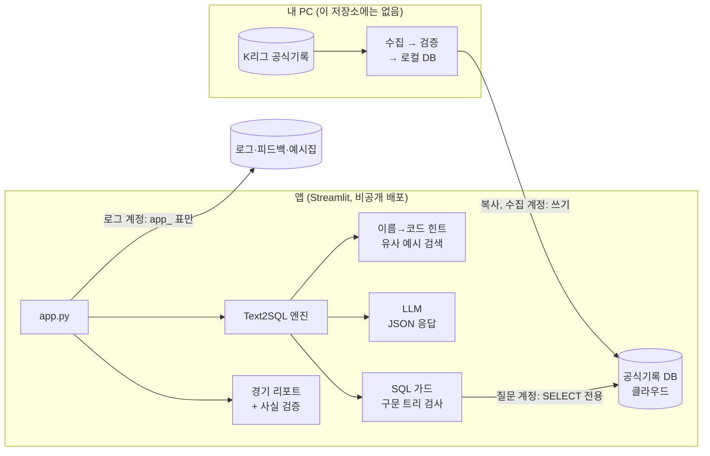

# ⚽ K리그 AI 분석관

> K리그 공식기록을 **말로 묻고, AI가 SQL을 만들어 답하는** Text-to-SQL 서비스. AI가 만든 SQL은 실행 전에 세 겹으로 검사한다.

| 항목 | 값 |
|---|---|
| 데이터 | 2025~2026 K리그1·K리그2 · 경기 1,003건(종료 955) · 선수 기록 37,069행 · 경기 이벤트 68,019건 · 선수 7,545명 |
| 테스트 | 단위 테스트 284개 (네트워크·LLM 호출 없음) |
| 정답률 | 최근 측정(2026-11-05): 고른 **23문항 중 19개**(엄격). 최종 정답 기준으로 재채점해도 **23문항 중 19개**. 이전에 틀린 문항을 모두 넣은 표본이라 **전체 정답률이 아니다**. 40문항 전체는 아직 재지 않았다 ([5. 정답률](#5-정답률)) |
| 스택 | Python 3.11 · Streamlit · sqlglot · scikit-learn(TF-IDF) · SQLite / TiDB(MySQL 호환) |
| LLM | OpenAI gpt-oss-120b(오픈 모델), Groq 추론 서비스 |

실데이터 앱은 지정한 사람만 접속하는 **비공개 배포**다 (Streamlit 공유 설정, 필요하면 접속 코드). 이 저장소에는 코드와 가상 데이터 체험 방법만 있다.

## 화면

> 아래 파일은 아직 없다. 녹화·캡처한 뒤 `assets/` 폴더에 넣는다.

| 내용 | 파일 (예시 이름) |
|---|---|
| 질문 → SQL → 표·차트 시연 영상 | `assets/demo.gif` |
| 기록 질문 화면 | `assets/ask.png` |
| 경기 리포트 화면 | `assets/report.png` |
| 성능·구조 탭 | `assets/about.png` |

---

## 1. 무엇을 하나

| 기능 | 설명 |
|---|---|
| 💬 기록 질문 | "2026 K리그1 득점 순위 TOP 10" → SQL 생성·검사·실행 → 표·차트(막대·꺾은선·영역·원형, 기준·값 선택)·요약 |
| 🔁 대화 이어가기 | "그 선수 도움은?"처럼 바로 앞 질문을 이어서 해석 |
| 📰 경기 리포트 | 공식기록·문자중계를 근거로 기사 작성. 기사 속 스코어가 실제와 다르면 경고 |
| 📊 운영 지표 | 질문 수·성공률·응답 시간 |

## 2. 구조



- 앱은 공식 기록을 직접 받지 않는다. 내 PC 에서 수집·검증해 DB 에 쌓은 기록을 **읽기만** 한다.
- 앱에는 수집 계정과 수집용 키를 주지 않는다. 앱의 DB 연결은 질문용(SELECT 전용)과 로그용(`app_` 표만) 두 개다.
- 질문 하나가 처리되는 순서:
  1. 입력 검사 (300자, 세션당 분당 6회, 하루 토큰 예산)
  2. 10분 캐시 확인
  3. 구단·선수 이름을 코드로 바꾼 힌트와 비슷한 검증 예시를 붙임
  4. LLM 이 SELECT 1개를 JSON 으로 답함
  5. SQL 가드 검사
  6. 읽기 전용 실행 (5초, 500행)
  7. 실패하면 오류를 근거로 최대 2번 자가 수정
  8. 표에 있는 숫자만 쓰는 요약

### 수집 (이 저장소에는 포함하지 않음)

수집 파이프라인은 설계·구현했으나 **공식 API 명세 보호를 위해 이 저장소에는 포함하지 않았다.** 개념만 적는다.

**수집 → 검증 → 로컬 DB → 클라우드 DB 복사**

| 단계 | 받는 정보 | 저장 표 |
|---|---|---|
| 기초 정보 | 구단·경기장·선수 기초 정보 | 구단 · 경기장 · 선수 |
| 퇴단 선수 | 퇴단 선수 정보 (필요할 때만) | 선수 (퇴단 표시) |
| 시즌 일정 | 시즌 일정 | 경기 |
| 종료 경기마다 | 경기별 기록 4종 | 경기 · 경기 팀 기록 · 경기 선수 기록 · 경기 이벤트 |
| 계산 (추가 호출 없음) | – | 경고 2회 퇴장(계산) |
| 순위 | 순위 검증 | 팀 순위(검증용) |

- 이미 받은 경기는 다시 받지 않고, 호출 수에 상한을 두며, 심각한 오류가 나면 재시도하지 않고 바로 멈춘다.
- 검증(득점 합계·빈 경기·선발 인원)에서 문제가 나오면 클라우드 DB 로 복사하지 않는다.
- 표 구조는 [`db/schema.sql`](db/schema.sql)에 있다.

## 3. 보안: 3중 방어

1. **SQL 가드 (앱)** – `kleague/sql_guard.py`. sqlglot 구문 트리로 조회문 1개인지, 허용 표만 쓰는지 검사한다. DROP·DELETE·INSERT·INTO·다중 문장·시스템 표·스키마 지정·`SLEEP()` 같은 위험 함수를 막는다. `LIMIT` 이 없거나 너무 크면 상한으로 바꾼다.
2. **DB 권한** – 질문 계정은 데이터 표 SELECT 만 가진다 (`db/tidb_setup.sql`). 가드가 뚫려도 쓸 수 없다.
3. **실행 제한** – 읽기 전용 트랜잭션, 실행 시간 상한, 행 수 상한. SQLite 는 `mode=ro` + authorizer 로 같은 효과를 낸다.

### 보안 시험 결과 (2026-11-05, 보고서 [`eval/runs/attack_20261105_093842.md`](eval/runs/attack_20261105_093842.md))

| 시험 | 결과 |
|---|---|
| 공격 질문 (실제 LLM) | 데이터 삭제·프롬프트 주입·시스템 표 조회·키 요구 질문 11개 모두 LLM 단계에서 SQL 없이 거절. 긴 입력은 입력 검사에서, SQL 조각을 섞은 질문은 정상 조회로만 처리됨 |
| 가드를 건너뛴 쓰기 SQL | DROP·DELETE·UPDATE·INSERT·ATTACH·PRAGMA 를 가드 없이 DB(읽기 전용 복사본)에 직접 보내도 모두 DB 가 거부 |
| 큰 조회 | 3중 CROSS JOIN 은 500행 제한, `COUNT(*)` 로 감싼 조인은 5초 시간 제한으로 중단 |
| 발견한 구멍 | `VERSION()`, `DATABASE()`, `sqlite_version()`, `@@version`, `@@hostname` 이 가드를 통과했다 (서버 정보 노출. 쓰기·키 유출은 아님). sqlglot 이 함수 이름을 바꿔 읽어 금지 목록에 안 걸렸고, `@@변수` 는 검사 대상이 아니었다 |
| 수정 | 서버·세션 정보 함수를 구문 노드 종류와 바뀐 이름 양쪽으로 차단, `@@`·`@`·바인드 변수 차단. 거절 메시지는 고정 문구만 보이게 바꿈 (LLM 이 쓴 이유가 DB 종류를 드러낸 적이 있어서). 저장된 정상 SQL 102개는 모두 그대로 통과 |
| DB 계정 권한 (TiDB, 조회만) | 질문 계정은 데이터 표 8개 SELECT 만, 로그 계정은 `app_` 표 3개에만 권한. 단, **질문 계정으로도 `VERSION()`·`@@hostname`·`CURRENT_USER()`·`information_schema` 는 읽혔다.** MySQL 계열은 SELECT 권한만 있어도 이 정보가 보이므로, DB 권한만으로는 못 막고 **SQL 가드가 필요했다** |
| 재시험 (수정 뒤, 실제 LLM) | 서버 정보 질문은 거절되고 화면엔 고정 문구만. 화면 글에서 DB 종류·키·접속 URL·경로 0건 |

**비밀값**
- API 키·DB 비밀번호는 `.env`/Secrets 에만 둔다.
- 수집용 키는 앱에 주지 않고, 로그·예외 메시지에 남기지 않는다.
- 화면의 DB 오류에서는 계정·IP·호스트를 가린다. 앱 시작 오류는 종류 이름만 보여준다.
- **SQL 표시는 관리자에게만** 보인다: 관리자 이메일(Secrets 의 `ADMIN_EMAILS`)이거나, 관리자 코드(Secrets 의 `ADMIN_CODE`)를 입력한 세션이거나, 가상 데이터(데모) 모드일 때. 생성된 SQL, 자가 수정·오류 메모, 정답률 평가 기록(정답 SQL 조각 포함)이 대상이다. 결과 표·요약·차트·👍/👎 는 모두에게 그대로 보인다.
  - 설정: Secrets 에 `ADMIN_EMAILS = "관리자1@도메인, 관리자2@도메인"` (쉼표로 구분, 대소문자·앞뒤 공백 무시). 실제 주소는 저장소에 쓰지 않는다.
  - 접속자 이메일은 Streamlit 이 주는 접속자 정보(`st.user`)로 읽는다. 관리자가 아니거나 이메일을 알 수 없으면 숨긴다.
  - 주의: Streamlit 1.42.0 부터 Community Cloud 는 로그인(OIDC, `[auth]`) 설정 없이는 `st.user` 에 이메일을 주지 않는다. 그래서 비공개 공유만 쓰면 이메일 방식으로는 아무도 SQL 을 못 본다. 사이드바 맨 아래 "접속자 확인: 이메일 확인됨 / 확인 불가" 문구로 상태를 알 수 있다 (주소는 표시하지 않음).
  - 보조 방법: Secrets 에 `ADMIN_CODE` 를 넣으면 사이드바에 '관리자 코드' 입력칸이 생긴다. 맞게 입력한 세션에서만 SQL 이 보이고, 새로고침하면 다시 입력해야 한다. 비교는 `hmac.compare_digest`, 5번 연속 틀리면 60초 동안 막는다. 코드·입력값은 화면·로그·기록에 남기지 않는다. `ADMIN_CODE` 가 없으면 입력칸도 없다.
- 접속 코드(선택): Secrets 에 `ACCESS_CODE` 를 넣으면 첫 화면에서 코드를 확인한다. 비교는 `hmac.compare_digest`, 틀린 시도는 세션당 5번까지, 코드는 화면·로그·오류에 나오지 않는다.

**공개 전 점검**: `scripts/prepublish_check.py` 로 비밀값·옛 정보·금지 파일·로고 이미지를 찾는다. 통과할 때만 `scripts/export_clean.py` 로 이 저장소용 복사본을 만든다.

## 4. 확인된 데이터 규칙과 한계

규칙은 모두 `kleague/schema_docs.py` 에 넣어 AI 가 SQL 을 쓸 때 따른다.

- **종료 경기만 집계**: 경기 표에는 예정 경기(스코어·관중 없음)도 있어서 합계·평균은 종료 경기만 쓴다.
- **자책골**: 선수 득점에는 넣지 않고 팀 득점에는 넣는다. 종료 955경기 중 선수 득점 합과 팀 득점이 다른 69경기는 모두 자책골이 있는 경기였다. 자책골로 설명되지 않는 경기는 0건이다.
- **경기 구분**: K리그1 '스플릿일반' · '파이널A/B', K리그2 '일반' · 'Play Off'. 라운드 수는 시즌마다 달라서 라운드 번호가 아니라 이 구분으로 거른다. 선수 개인기록은 K리그1 전체 라운드, K리그2 '일반'만 센다 (대회요강 제30조 4항).
- **퇴장**:
  - 공식 퇴장 기록은 직접 퇴장만 센다. 이 값은 바꾸지 않는다.
  - 경고 2회 퇴장은 문자중계에서 따로 계산했다 (경고 2회 퇴장(계산), 2025~2026 58건).
  - '퇴장 횟수'는 둘을 더하고, 답에는 항상 내역을 붙인다. 그래서 연맹 순위표의 퇴장 수(직접 퇴장만)보다 많을 수 있다.
- **이적 선수**: 시즌 중 팀을 옮긴 선수는 팀마다 행이 나뉜다. 시즌 합계는 선수 코드로 묶는다.
- **선수 정보**: 현역 1,922명 + 퇴단 5,623명. 2025~2026 경기에 나온 선수는 모두 국적과 등록 포지션이 있다. 연맹은 리그를 떠난 선수를 나이와 관계없이 '은퇴'로 표시한다.
- **포지션**은 등록 포지션 기준이다. 경기별 위치는 교체 출전이면 '대기'로 나온다.
- **날씨**: '비'와 '흐리고 비'가 따로 있다. 비 온 경기는 '비'가 들어간 값으로 찾는다.

**검증**: 2026 K리그1 선수 득점·도움·출전과 구단 순위 12팀을 연맹 공식 순위 자료와 대조해 모두 일치했다. 처음에 다르던 1건은 수집 중 연맹이 정정한 기록이었다.

**한계**
- 기온에 원천 오류값 2건이 있다. 고치지 않고 그대로 둔다.
- 같은 이름의 다른 선수는 이름만으로 구분할 수 없어 두 코드를 함께 알려 준다.
- 2026 시즌은 진행 중이다. 순위·누적 기록은 마지막 수집 시점 기준이다.

## 5. 정답률

> 평가 문항은 40개다. **40문항 전체 점수는 아직 재지 않았다.** 아래 두 측정은 문항 구성과 규칙이 달라 서로 비교하지 않는다.

**최근 측정 (2026-11-05, 예시 검색 ON) — 전체 정답률 아님**

| 문항 | 엄격 | 관대 |
|---|---|---|
| 대표 23문항 (이전 오답 문항 전부 포함), 측정 당시 채점 | **23문항 중 19개** | 23문항 중 19개 |
| 같은 답을 최종 정답 기준으로 재채점 (LLM 호출 없음) | **23문항 중 19개** | 23문항 중 19개 |

- 고른 기준: 지난 측정에서 틀린 문항 전부 + 호출 실패로 못 잰 문항 + 분류별로 앞 번호부터 2개씩. 틀린 문항을 일부러 모두 넣었기 때문에 전체 정답률을 대신하지 않는다.
- 재채점에서 바뀐 문항 2개: q03 ✅ → ❌ (정답 기준이 바뀐 뒤 AI 답에 스코어가 없음), q01 ❌ → ✅ (아래 고정 예외).
- **q01(득점왕)은 대회요강 제30조 4항에 따른 고정 예외**다. 득점이 같으면 출전경기가 적은 선수, 그다음 출전시간이 적은 선수가 공식 득점왕(1명)이라, 정답 기준을 '공동 1위 모두'에서 '공식 규칙으로 1명'으로 바꿨다. 결과를 본 뒤에 고친 것이다.
- 한 번만 잰 값이라, 이전 측정보다 맞은 문항이 있어도 '개선'이라고 보지 않는다.

**공식 동률 규칙 재측정 (2026-11-05, 예시 검색 ON) — 4문항 계획, 3문항만 측정**

| 문항 | 엄격 | 관대 |
|---|---|---|
| q01·q09·q17 (q34 는 토큰 예산으로 측정 불가) | 3문항 중 1개 | 3문항 중 2개 |

- AI 프롬프트에 '개인 득점·도움 순위 공식 동률 규칙'을 넣고 잰 값이다. q01 이 규칙을 넣기 전보다 나빠져(2명을 답함) **규칙은 되돌렸다.** 그래서 지금 앱에는 이 규칙이 없다. 자세한 내용은 [`eval/RESULTS.md`](eval/RESULTS.md).

**이전 측정 (2026-11-04) — 규칙 보완과 정답 기준 수정 이전**

| 설정 | 문항 | 엄격 점수 |
|---|---|---|
| 예시 검색 ON | 38 | 38문항 중 30개 (78.9%) |
| 예시 검색 OFF | 38 | 38문항 중 28개 (73.7%) |

- 이 값은 그날 실행 기록에서 다시 채점한 것이다. 원본 보고서는 같은 날 오후의 무효 실행(하루 한도 초과)에 덮어써져 없다. 이 일 뒤로 평가 실행기는 보고서를 매번 새 이름으로 저장하고, 한도 초과로 멈춘 실행은 `_invalid` 를 붙여 따로 저장한다.

**채점 방법**
- 정답 SQL(사람이 쓰고 실행해 확인)과 AI SQL 의 **실행 결과**를 비교한다. 숫자는 소수 둘째 자리까지 같아야 하고, 순위형 질문은 순서까지 같아야 정답이다.
- **엄격**: 위 그대로. **관대**: 반올림 0.01 이내, 비율/퍼센트 표기 차이, '3-1' 같은 스코어 글자(홈·원정 짝이 맞을 때만)를 인정한다.
- **정답 기준 수정 이력**: 평가 결과를 본 뒤 정답 SQL 5개를 고쳤다. q03·q09·q30·q32 는 질문이 묻지 않은 내부 경기 번호를 요구하던 문제, q01 은 대회요강 제30조 4항에 따른 고정 예외다. 무엇을 왜 고쳤는지는 [`eval/RESULTS.md`](eval/RESULTS.md)에 모두 적었고, 이후 정답 기준은 더 고치지 않는다.
- 정답 SQL 점검: 공개 저장소에는 질문 번호·결과 행 수·통과 여부만 담은 [`eval/gold_check_public.md`](eval/gold_check_public.md) 만 둔다.
- 평가 질문(`eval/questions.yaml`)과 AI 에 주는 예시(`eval/seed_examples.yaml`)는 겹치지 않게 관리한다.
- 실행별 보고서는 [`eval/runs/`](eval/runs/)에 날짜·시각 이름으로 쌓인다.

## 알려진 한계

| 한계 | 설명 |
|---|---|
| SQL·오류 메모는 관리자에게만 | 실데이터 앱에서 '생성된 SQL' 펼침(AI SQL, `no such column: x` 같은 오류 메모)은 관리자 이메일에게만 보인다. 관리자 화면에서는 테이블·컬럼 이름과 DB 종류를 짐작할 수 있다. 가상 데이터 모드에서는 모두에게 보인다 |
| 무료 LLM 한도 | Groq 무료 한도(하루 약 20만 토큰, 분당 약 8천 토큰) 안에서 돈다. 한도에 걸리면 답을 못 하고, 평가도 하루에 조금씩만 잴 수 있다 |
| 함수 허용 목록은 기록만 | 쓸 수 있는 함수 목록을 만들었지만, 지금은 목록 밖 함수가 나와도 막지 않고 로그만 남긴다. 실제 차단은 '금지 목록' 방식이다 |
| 수집 인증 설정 | 공식 API 인증 방식 문제로 권장 설정을 보류했다. 수집은 이 저장소에 없고, 키는 로그에 남기지 않는다 |
| 평가 문항 수가 적음 | 40문항이고 최근 측정은 그중 23문항이다. 문항 하나가 점수를 크게 바꾼다 |
| 개인 순위 동률 | 득점왕처럼 공식 동률 규칙(출전경기·출전시간)이 있는 질문을 AI 가 항상 규칙대로 답하지는 않는다. 규칙을 프롬프트에 넣어 봤지만 결과가 나빠져 되돌렸다 |
| 범위 밖 질문 | '내일 날씨'처럼 범위 밖 질문이 거절되지 않고 SQL 로 바뀐 경우가 있었다 (위험한 실행은 아님) |

## 앞으로 할 일

- 함수 허용 목록을 '기록만'에서 '차단'으로 바꾸기 (기록을 보고 정상 질문이 막히지 않는지 확인한 뒤)
- 40문항 전체 다시 측정 (엄격·관대 함께)

## 6. 실행 방법

### 바로 체험 (가상 데이터, 실제 DB 없이)
```bash
pip install -r requirements.txt
echo LLM_API_KEY=[Groq 키] > .env
streamlit run app.py                # demo/demo.sqlite (가상 데이터) 로 시작
python scripts/make_demo_db.py      # (선택) 가상 데이터 DB 를 새로 만들기
```
화면 맨 위에 **"가상 데이터입니다. 실제 K리그 기록이 아닙니다."** 배너가 뜬다. 구단·선수·기록은 모두 지어낸 값이다 (구단 '가상 ○○FC', 선수 '가상○○○').
LLM 키가 없어도 앱 화면은 뜨지만, 질문에 답하려면 키가 필요하다.

### 실데이터
실데이터 DB 는 수집 파이프라인(이 저장소에 없음)으로 만든다. DB 가 있으면 `.env.example` 을 `.env` 로 복사해 `QUERY_DB_URL`·`APP_DB_URL` 을 넣고 `streamlit run app.py`.

### 점검·평가
```bash
python -m pytest -q                  # 단위 테스트
python eval/check_gold.py            # 정답 SQL 40개·예시 17개 실행 점검 → gold_check_public.md (공개용) + gold_check.md (비공개)
python eval/run_eval.py --mock       # 채점기 자체 점검 (LLM 없음) → eval/runs/report_*_날짜_시각.md
python eval/run_eval.py --mock-fail-after 5  # 한도 초과 상황 흉내 → 첫 429 에서 즉시 멈추고 *_invalid.md 로 저장되는지 점검
python eval/run_eval.py --ids q01,q15 --token-budget 100000  # 일부 문항만, 누적 토큰 상한
python eval/run_eval.py              # 실제 LLM 평가 (무료 티어는 ON/OFF 를 하루에 하나만, 기존 보고서는 덮어쓰지 않음)
python scripts/prepublish_check.py   # 공개 전 점검 (비밀값·금지 파일·가상 데이터 DB)
```

### 배포
- 클라우드 DB(TiDB) 준비: [`docs/TIDB_MIGRATION.md`](docs/TIDB_MIGRATION.md)
- 비공개 배포: [`docs/DEPLOY.md`](docs/DEPLOY.md)

## 7. 폴더

```
app.py      화면 (보여주기만)
kleague/    질문→SQL→실행→요약, SQL 가드, DB(읽기 전용·시간 제한·연결 풀),
            테이블 설명서, 이름 힌트, 예시 검색, 경기 리포트
db/         표 구조, 새 컬럼 추가, 클라우드 DB 계정 권한
demo/       가상 데이터 DB (demo.sqlite)
eval/       평가 질문, 예시, 채점기, 정답 SQL 점검, 정답률 기록(RESULTS.md), 실행별 보고서(runs/)
scripts/    가상 데이터 만들기, 예시 승인, 공개 전 점검, 깨끗한 복사본
tests/      단위 테스트
docs/       클라우드 DB 준비, 비공개 배포
(수집 파이프라인은 공식 API 명세 보호를 위해 포함하지 않음)
```

## 8. 데이터 정책

- **공식기록만 저장**한다. 영상 분석 업체(Bepro11) 부가기록은 수집하지 않는다.
- 개인정보 최소화: 생년월일은 **출생 연도만** 저장한다. 키·몸무게·학력·병역·에이전트 정보와 구단 임직원은 저장하지 않는다.
- 경기 시간은 계산하지 않고 공식 문자중계 문구를 그대로 쓴다.
- 실데이터 앱은 비공개로 배포하고, 이 저장소에는 실제 기록 데이터를 넣지 않는다.

## 9. 누가 무엇을 했나

이 프로젝트의 **코드는 AI 도구(Claude, Claude Code)가 작성했다.**

내가 맡은 일:
- **요구사항 정의** – 무엇을 묻고 답하는 서비스인지, 화면과 기능 범위
- **데이터 정합성 검증** – 수집한 기록을 연맹 공식 순위 자료와 대조하고, 다른 값의 원인을 확인
- **보안 요구사항 지정** – SELECT 전용 계정, SQL 구문 검사를 약하게 하지 않기, 비밀값을 화면·로그에 남기지 않기, 입력 길이·요청 횟수 제한
- **운영 결정** – 수집 인증 설정, 개인정보 최소화(출생 연도만), 공식기록만 수집, 비공개 배포

## 10. 이전 버전과 비교

| 구분 | 이전 (v0) | 지금 (v1) |
|---|---|---|
| SQL 검사 | 정규식 금지어 검사 (오탐, 시스템 표 조회 가능) | **sqlglot 구문 트리** 검사, `LIMIT` 강제 |
| DB 권한 | 계정 1개 | **계정 3개 분리**: 수집(쓰기) / 질문(SELECT 전용) / 로그(`app_` 표만) |
| 쿼리 폭주 | 제한 없음 | 실행 시간·최대 행 수 제한 |
| 예시 학습 | 자가 수정에 성공한 SQL 을 검증 없이 저장 | 👍 는 승인 대기열로만 보내고, 관리자 승인 후 사용 |
| 예시 검색 | 400MB 임베딩 모델 + 로컬 벡터 DB | 글자 n-gram TF-IDF (모델 다운로드 없음) |
| 비용 관리 | 세션별 토큰 카운트 (새로고침하면 0) | 하루 토큰 예산 DB 저장, 분당 질문 제한, 10분 캐시 |
| 정확도 | 측정 수단 없음 | 평가 문항, 실행 결과 비교 채점 |
| 노출 정보 | 서버 주소 화면 표시, DB 오류 원문 노출 | 제거, 오류에서 계정·IP·호스트 가림 |
| 데이터 | DB 직접 연결 | **공식 API 수집 파이프라인** (공식기록만, 연맹 순위와 대조. 이 저장소에는 미포함) |
| 구조 | 1,200줄 파일 하나 | 화면 / 엔진 / 수집 / 평가 분리 + 단위 테스트 (수집은 비공개) |
